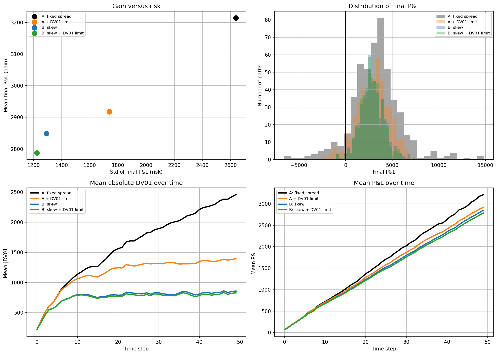
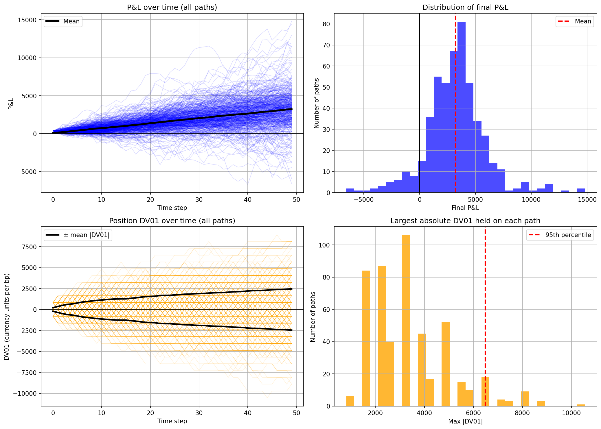
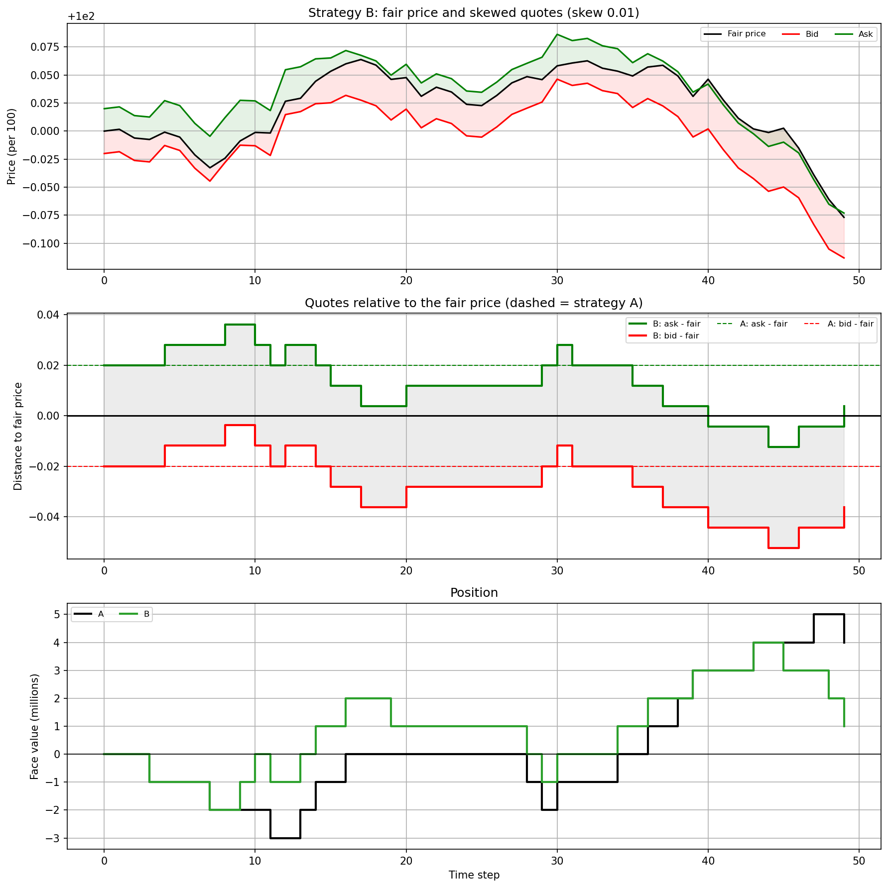
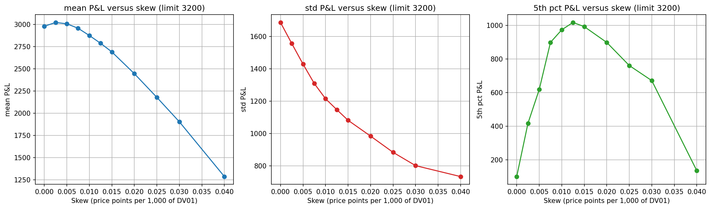

# Rates Market Maker: a simulation to learn the basics

> **This is an educational project.** I built it to understand the core mechanics of market making in rates: quoting two-way prices, trading with clients, accumulating inventory, and measuring interest-rate risk with DV01. It is a deliberately simplified model, **not** a realistic trading system. Real market makers use far more sophisticated algorithms and far more data than a spread with an inventory skew; I only know their general principles, and this project does not try to reproduce them. The goal here is to understand one mechanism well, and to test it honestly.

**Author:** Nicolas Woblik

## Summary

A market maker earns the bid-ask spread, but every trade changes its inventory, and an inventory of bonds is exposure to interest rates. The question of the project:

**Can a market maker keep earning the spread while keeping its interest-rate risk under control?**

I simulate a rate, price a 10-year bond and its DV01, quote a bid and an ask, let probabilistic clients trade with the quotes, track position, cash, mark-to-market P&L and DV01, and compare three ways of managing risk: a fixed spread (Strategy A), a fixed spread with a hard DV01 limit (Strategy A + limit), and quotes **skewed by inventory** (Strategy B).

## Key result

At the same hard DV01 limit, skewing the quotes against the inventory cuts the dispersion of the P&L by 28% and the average DV01 by 36%, for a 3.5% lower average P&L. The skew alone, without any limit, already cuts the dispersion by 25% compared with the hard limit, for 2% less P&L.

| Strategy | Mean P&L | Std of P&L | 5th percentile of P&L | Paths with a loss | Mean abs. DV01 |
|---|---|---|---|---|---|
| A: fixed spread | 3,236 | 2,459 | -628 | 7.1% | 1,587 |
| A + hard DV01 limit | 2,978 | 1,686 | +100 | 5.0% | 1,147 |
| B: skew | 2,921 | 1,261 | +984 | 1.2% | 748 |
| B: skew + same hard limit | 2,875 | 1,215 | +974 | 1.2% | 733 |

*Average over 5 independent simulations of 500 paths x 50 steps. P&L in currency units, trades of 1M face value. The differences in mean P&L are of the order of the simulation-to-simulation noise (about 70 to 90), whereas the reductions in dispersion and tail risk are several times larger than that noise; the ranking is the same in each of the 5 simulations.*



*Figure: gain versus risk, distribution of the final P&L, mean absolute DV01 over time, and mean P&L over time, for the four strategies (first simulation only, so the values differ slightly from the table above, which averages 5 simulations).*

## The model

| Ingredient | Choice |
|---|---|
| Rates | Arithmetic random walk starting at 4%, normal shocks of 0.15 bp per step, 50 steps |
| Bond | 10-year, 4% annual coupon, priced by discounting its cash flows (vectorised with NumPy) |
| Risk | DV01 = price loss for +1 bp (about 0.0811 per 100 of face value); a 1M position has a DV01 of about 811 |
| Quotes | `bid = fair - half_spread`, `ask = fair + half_spread`, half-spread of 0.02 per 100 |
| Clients | At each step, at most one buys at our ask and one sells at our bid, with probability `p = flow * exp(-sensitivity * gap)` capped at 1 (`flow = 0.3`, `sensitivity = 30`); `gap` is how much worse than the fair price the quote is |
| Trades | Fixed size of 1M face value |
| Accounting | Position (face value held), cash, and mark-to-market `P&L = cash + position / 100 * fair price` |

Every strategy is run on exactly the same simulated rates and the same random client draws (common random numbers), so differences between strategies come from the strategy only.

## The strategies

**A: fixed spread.** Quotes are always symmetric around the fair price. Inventory then follows a random walk with nothing pulling it back, so the DV01 keeps growing over time and the P&L becomes more and more dispersed.



*Figure: strategy A over 500 paths: P&L over time, distribution of final P&L, position DV01 over time, and largest absolute DV01 held on each path.*

**A + hard DV01 limit.** Same quotes, but a trade is refused if it would push the absolute DV01 of the position above a limit (3,200, about 4M of face value). A trade that reduces the risk is always accepted. This caps the risk bluntly, at the price of refused trades and therefore lost spread.

**B: inventory skew.** Both quotes are moved together against the inventory:

`shift = skew * position DV01 / 1,000`, `bid = fair - half_spread - shift`, `ask = fair + half_spread - shift`

When we are long, both quotes move down: the ask becomes more attractive (more clients buy from us) and the bid less attractive (fewer clients sell to us), so the inventory drifts back towards zero. When we are short, the opposite happens. The spread width does not change; only its centre moves. The price of this is that we sometimes sell slightly below the fair price to reduce risk.



*Figure: strategy B on one simulated path: quotes relative to the fair price (dashed lines show the fixed spread of A) and the position of B. This single path is an illustration, not a proof; the statistics above are the evidence.*

## How the skew was chosen

I did not pick the skew by eye. I swept a grid of 11 values (0 to 0.04) with the hard limit fixed at 3,200, averaged over 5 independent simulations:

- the **standard deviation** of the P&L falls continuously as the skew grows;
- the **mean P&L** is almost flat up to a skew of about 0.0075, then falls faster and faster;
- the **5th percentile** of the P&L peaks around 0.0125, then falls: past that point the skew costs more than it protects. With a skew of 0.04 the average P&L collapses (-57%).

The optimal skew depends on what is being optimised. I fixed the criterion **before** looking at the value: *the largest reduction in risk while losing at most 5% of the mean P&L compared with A + limit*. It selects a skew of **0.01** (-3.5% of mean P&L; 0.0125 already exceeds the 5% budget at -6.4%). I checked it out of sample: the criterion selects 0.01 both on the first three simulations and on the last two.



*Figure: mean P&L, standard deviation and 5th percentile of the P&L as a function of the skew (hard limit of 3,200, average over 5 simulations).*

## Limitations: what this model does not do

Being honest about these is the point of an educational project.

- **No adverse selection.** Clients react only to price. Real clients may know something the dealer does not, so a skewed or off-market quote has a hidden cost that this model does not capture. This makes the skew look cheaper than it probably is.
- **No hedging.** The only risk tool is the quote. Real desks hedge inventory in liquid instruments (futures, swaps) and manage risk across many books.
- **One bond, one yield.** No term structure, only parallel moves of a single rate, no basis or curve risk.
- **The fair price is known exactly.** No estimation noise, no stale or conflicting market data.
- **Stylised rates.** A random walk with constant volatility: no mean reversion, rates can go negative, no jumps, no volatility clustering.
- **Hand-set parameters.** Client flow, price sensitivity, spread and volatility are assumptions, not calibrated on data. The results depend on them, especially on how price-sensitive the clients are: with less sensitive clients the skew would be less effective.
- **Simple client and trade structure.** At most one buy and one sell per step, fixed trade size, no client types, no request-for-quote dynamics. The length of a step is not defined.
- **No costs or constraints.** No fees, funding costs, capital or balance-sheet limits.
- **A heuristic, not an optimal policy.** The linear skew and its calibration by grid search are not derived from an optimal control model.
- **Limited statistics.** 5 simulations of 500 paths: differences in mean P&L are within the noise. The hard limit is checked at trade time, so the DV01 of a fixed position can drift slightly above it when the rate moves.

## Possible extensions

- Dynamic spread: widen the spread as the risk grows (a first test suggests a modest gain at equal risk when combined with the skew; it would need its own calibration).
- A mean-reverting rate model (Vasicek) in place of the random walk.
- Calibrating the rate volatility on real data (for example from FRED).
- Yield-curve shocks and several instruments with hedging.
- Informed clients (adverse selection) and a comparison with optimal inventory-control models such as Avellaneda-Stoikov.

## How to run

```
pip install -r requirements.txt
jupyter notebook rates_market_maker.ipynb     # then Restart kernel and Run All (about 15 seconds)
pytest                                        # unit tests of the toolbox
```

All random draws use fixed seeds, so the results are reproducible. The figures are saved in `figures/`.

## Repository layout

```
market_maker.py              toolbox: pricing, DV01, rate simulation, quotes, clients, strategy simulator, statistics
rates_market_maker.ipynb     the experiments: strategies A and B, robustness, skew calibration, final results
tests/test_market_maker.py   unit tests (hand-computed cases, non-regression, hard-limit checks)
figures/                     images used in this README
report/                      longer methodology report (design choices and justification of the skew)
requirements.txt
```
